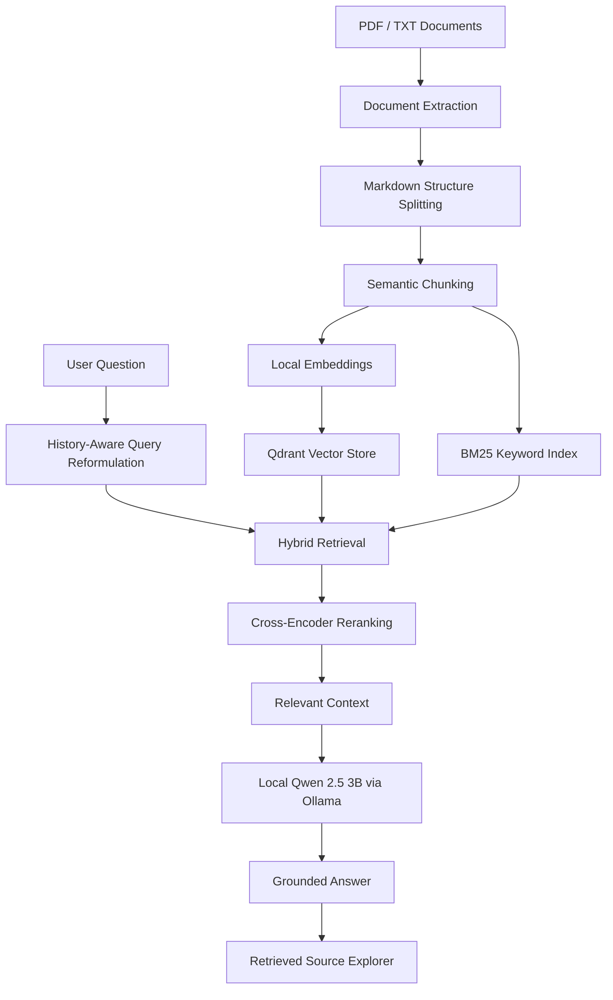

# 🧠 Hybrid RAG — Local & Privacy-Focused AI Knowledge Assistant

A locally hosted Retrieval-Augmented Generation (RAG) application that lets users ask questions about their own PDF and TXT documents. Built with Streamlit, LangChain, Qdrant, Hugging Face, and Ollama, it combines semantic search, keyword retrieval, cross-encoder reranking, and conversational question reformulation to produce context-grounded answers.

The project is designed for privacy-conscious environments where documents and model inference should remain on the local machine.

---

## ✨ Key Features

- **Local LLM inference:** Generate responses using Qwen 2.5 3B through Ollama.
- **Hybrid retrieval:** Combine dense-vector search with BM25 keyword search.
- **Cross-encoder reranking:** Reorder retrieved passages by relevance before generation.
- **Semantic chunking:** Split documents using semantic similarity, with Markdown-aware preprocessing.
- **Conversational memory:** Resolve follow-up questions using chat history.
- **Source-aware answers:** Inspect retrieved passages and document metadata to verify responses.
- **Local vector storage:** Store embeddings in Qdrant's local mode.
- **Modern Streamlit interface:** Upload documents, monitor indexing status, chat with the knowledge base, and inspect retrieved sources.
- **PDF and TXT support:** Extract and process common document formats locally.

## 🏗️ System Architecture

The application follows a multi-stage retrieval and generation pipeline.



### 1. Document Processing

**PDF extraction — PyMuPDF4LLM**

Extracts document text while preserving useful structural information, including headings, lists, and table representations where supported by the source document.

**Structural and semantic chunking**

- `MarkdownHeaderTextSplitter` separates Markdown content using heading structure.
- `SemanticChunker` groups text according to semantic similarity.
- `RecursiveCharacterTextSplitter` provides a fallback for oversized or unsuitable text segments.

**Embeddings — BAAI/bge-small-en-v1.5**

Converts document chunks into dense vector representations using a locally loaded Hugging Face embedding model.

PDF source metadata, including page information, is retained where available to support source inspection and traceability.

### 2. Local Infrastructure and Storage

**Vector database — Qdrant**

Qdrant local mode stores and searches document embeddings without requiring a hosted vector database.

**Cached resources**

Streamlit's `@st.cache_resource` is used to reuse expensive resources, such as the Qdrant client and loaded models, across Streamlit reruns.

**Collection management**

The application can create a new collection for a fresh indexing operation and switch to it after the retrieval pipeline has been built successfully. This helps prevent stale document chunks from being mixed with the active corpus.

> Important: Qdrant local mode is designed for local application use. A shared, concurrent, multi-user deployment requires an appropriate server-backed storage architecture and additional access controls.

### 3. Hybrid Retrieval and Reranking

The retrieval pipeline combines two complementary search methods.

**Dense-vector retrieval**

Qdrant retrieves semantically similar passages using the BGE embedding model.

**BM25 keyword retrieval**

BM25 identifies passages containing important matching terms, which is useful for product names, technical terminology, identifiers, and exact phrases.

**Ensemble retrieval**

The two retrievers are combined using configurable weights.

Default configuration:

| Component | Setting |
|---|---|
| BM25 weight | 0.3 |
| Dense-vector weight | 0.7 |
| Candidates per retriever | 15 |
| Reranked passages | 4 |

These values are starting points for experimentation, not universal optimal settings.

**Cross-encoder reranking**

`BAAI/bge-reranker-base` scores the retrieved query-passage pairs and helps prioritize the passages most relevant to the question.

Only the selected passages are passed to the answer-generation chain.

### 4. Conversational Retrieval

A history-aware retriever reformulates follow-up questions into standalone questions when necessary.

For example:

- First question: "What is the headset's battery capacity?"
- Follow-up: "How long does it last?"

The reformulated query can include the headset reference so that retrieval can locate the relevant playback-time information.

Conversation history is used to interpret the user's question. Retrieved document content remains the evidence used for factual answers.

### 5. Local Answer Generation

**Inference engine:** Ollama  
**Model:** `qwen2.5:3b`

The LLM generates answers using retrieved document context and instructions intended to reduce unsupported claims.

The application is designed to:

- Answer questions using retrieved evidence.
- Acknowledge insufficient information when the evidence does not support an answer.
- Provide source references when the relevant metadata is available.
- Preserve conversational context for follow-up questions.

These controls reduce hallucination risk but cannot eliminate it. Retrieval quality, prompt adherence, and model behavior should be evaluated using a representative test set.

---

## 🔒 Privacy and Security

The application is designed around local document processing and inference.

When configured for local operation:

- Documents are parsed on the local machine.
- Embeddings are generated locally.
- Vector storage uses local Qdrant storage.
- LLM inference runs through the local Ollama service.

**Air-gapped deployment considerations**

A fully air-gapped deployment requires additional preparation:

1. Download Python dependencies and model files before disconnecting from the internet.
2. Verify that the embedding and reranking models are available locally.
3. Ensure Ollama has the required model installed.
4. Disable or avoid external services and network-dependent integrations.
5. Verify that the application can start and process documents without network access.

The interface may load fonts or other resources externally if configured to do so. For strict offline operation, remove external font imports and package all required assets locally.

Local execution alone does not guarantee complete privacy or security. Operating-system permissions, logging, backups, access controls, and model provenance must also be considered.

---

## 🛠️ Technology Stack

| Technology | Purpose |
|---|---|
| Python | Application and pipeline logic |
| Streamlit | Interactive web interface |
| LangChain | Retrieval and generation orchestration |
| PyMuPDF4LLM | PDF text and Markdown extraction |
| Hugging Face | Embedding and reranking models |
| Qdrant | Local vector storage and similarity search |
| BM25 | Sparse keyword retrieval |
| Sentence Transformers | Cross-encoder model support |
| Ollama | Local LLM inference |
| Qwen 2.5 3B | Answer generation |

---

## 📋 Prerequisites

- Python 3.10 or later
- Ollama installed
- Sufficient memory and storage for the selected models
- Internet access during initial dependency and model downloads, unless using a prepared offline environment

GPU acceleration is optional. CPU execution is supported by the configuration, although indexing and reranking may be slower.

AMD GPU acceleration depends on the operating system, hardware, and compatible Ollama backend. Installing AMD Adrenalin drivers alone does not guarantee that the configured model will run on the GPU.

---

## 🚀 Installation and Setup

### 1. Clone the repository

```bash
git clone <your-repo-url>
cd Assessment_5_RAG
```

### 2. Create a virtual environment

**Windows — PowerShell**

```powershell
python -m venv venv
.\venv\Scripts\Activate.ps1
```

**Linux / macOS**

```bash
python3 -m venv venv
source venv/bin/activate
```

### 3. Install dependencies

```bash
python -m pip install --upgrade pip
pip install -r requirements.txt
```

If a requirements file is not yet available, install the packages used by the project:

```bash
pip install streamlit pymupdf4llm qdrant-client \
  langchain-core langchain-community langchain-classic \
  langchain-qdrant langchain-huggingface \
  langchain-experimental langchain-text-splitters \
  langchain-ollama sentence-transformers rank-bm25
```

Use compatible package versions and test the imports against your implementation. LangChain packages evolve independently, so pin versions after validating a working environment.

### 4. Start Ollama and download the model

Install Ollama from:

https://ollama.com/

Pull the configured LLM:

```bash
ollama pull qwen2.5:3b
```

Verify the installed model:

```bash
ollama list
```

Ensure the Ollama service is running before starting the application.

### 5. Verify the project structure

The project should follow a structure similar to this:

```text
Assessment_5_RAG/
├── app.py
├── requirements.txt
├── src/
│   ├── __init__.py
│   ├── config.py
│   ├── document_processor.py
│   └── retrieval_engine.py
├── data/
│   └── HP_JBL_Q350_OM_V2_EN.pdf
├── rag_test_cases.json
├── TESTS.md
├── README.md
└── qdrant_local_db/
```

The `qdrant_local_db/` directory is created or used by the application for local vector storage.

Avoid committing generated databases, model weights, virtual environments, or uploaded documents unless they are intentionally included.

### 6. Launch the application

From the project root:

```bash
python -m streamlit run app.py
```

Open the local URL displayed in the terminal.

---

## 💬 Usage

1. Launch the Streamlit application.
2. Upload PDF and/or TXT documents through the sidebar.
3. Click **Index Documents**.
4. Wait for text extraction, chunking, embedding, and retrieval setup to finish.
5. Ask questions about the indexed documents.
6. Use follow-up questions to test conversational context.
7. Expand the source explorer below an answer to inspect the retrieved passages.
8. Compare answers against the original documents when validating accuracy.

### Example questions

- What are the key points in this document?
- Summarize the main findings.
- What specifications are mentioned?
- How does the document describe the troubleshooting process?
- Compare the two approaches described in the report.
- Where does the document discuss the relevant requirement?

---

## 🧪 Testing and Evaluation

RAG quality should be evaluated on more than whether the generated response sounds plausible.

A useful evaluation dataset should include:

| Test category | Purpose |
|---|---|
| Direct factual questions | Validate basic retrieval and answer correctness |
| Exact keyword questions | Evaluate BM25 retrieval |
| Semantic questions | Evaluate dense-vector retrieval |
| Multi-passage questions | Test retrieval coverage and synthesis |
| Follow-up questions | Test history-aware reformulation |
| Unanswerable questions | Evaluate unsupported-answer behavior |
| Citation checks | Verify source and page accuracy |

Measure retrieval recall, answer correctness, faithfulness, citation accuracy, and latency.

Use a fixed test set when changing chunk sizes, retrieval weights, reranker settings, or the LLM so that improvements can be compared consistently.

---

## ⚙️ Configuration

Model names, paths, retrieval parameters, and collection settings are centralized in `src/config.py`.

Example:

```python
LLM_MODEL = "qwen2.5:3b"
EMBED_MODEL = "BAAI/bge-small-en-v1.5"
RERANKER_MODEL = "BAAI/bge-reranker-base"

RETRIEVAL_K = 15
RERANK_TOP_N = 4

BM25_WEIGHT = 0.3
VECTOR_WEIGHT = 0.7
```

Tune these values according to document characteristics, evaluation results, available memory, and acceptable response times.

For small local LLMs, returning fewer high-quality passages may improve latency and reduce context noise. Conversely, questions requiring evidence from several passages may need a larger reranked context.

---
# Hybrid RAG evaluation scorecard

Evaluation targets · 18 test cases - rag_test_cases.json

# Target performance

Answer correctness

## 90%

Correct factual answers on answerable questions.

Retrieval quality

## 90%

Questions for which the retrieved chunks contain sufficient evidence.

Citation correctness

## 95%

Citations that identify the correct supporting document and page.

Hallucination resistance

## 95%

Unsupported questions handled without inventing facts.


## Calculaion Methods

| Metric | Calculation |
| --- | --- |
| Answer correctness | Correct answers ÷ answerable questions × 100 |
| Retrieval quality | Questions with sufficient evidence retrieved ÷ total test questions × 100 |
| Citation correctness | Correctly supported citations ÷ citations evaluated × 100 |
| Hallucination resistance | Unsupported questions handled without fabricated claims ÷ unsupported questions × 100 |

For JBL test suite, evaluate answerable and unanswerable questions separately. For example, if 10 answerable questions are tested and 9 are correct, answer correctness is 90%. If 4 unsupported questions are tested and all 4 are handled correctly, hallucination resistance is 100%.

---

## 🎯 Project Goal

The goal of this project is to demonstrate how a local-first RAG architecture can combine keyword retrieval, semantic search, reranking, and conversational context to make private document collections easier to query.

By keeping the core processing pipeline local and exposing retrieved evidence for inspection, the application provides a practical foundation for privacy-conscious document intelligence.

---

## 📄 License

Add your chosen license here. If you intend to distribute the project publicly, verify the licenses of the source code, model weights, and dependencies separately.

## 🙌 Acknowledgements

- [LangChain](https://www.langchain.com/)
- [Qdrant](https://qdrant.tech/)
- [Ollama](https://ollama.com/)
- [Hugging Face](https://huggingface.co/)
- [PyMuPDF4LLM](https://pymupdf.readthedocs.io/)
- [Streamlit](https://streamlit.io/)
